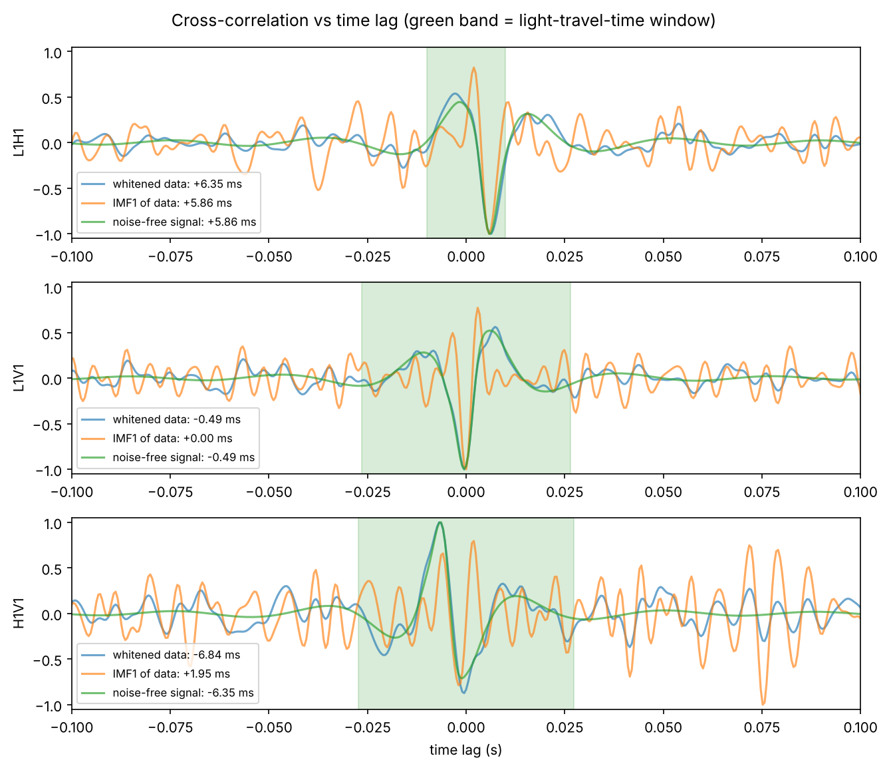
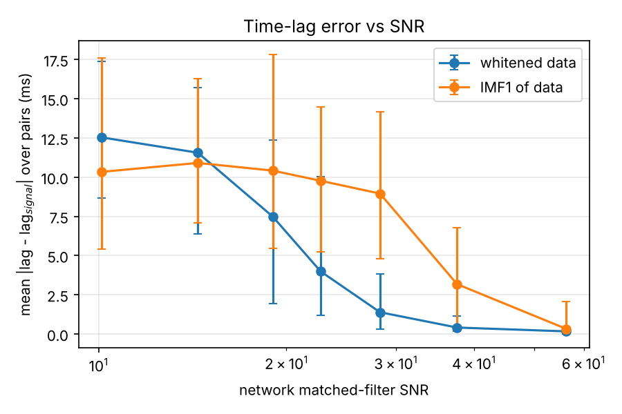
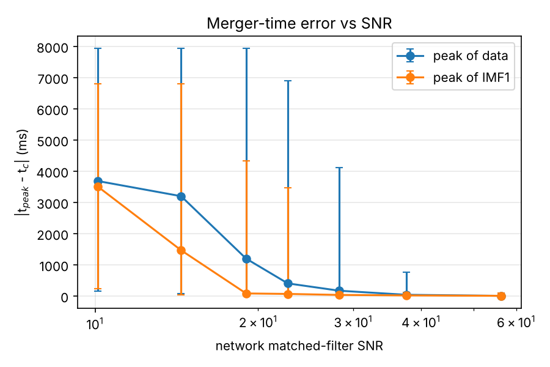

# gwhht - Hilbert-Huang transform and time-lag estimation for simulated GW signals

Python package + notebooks that inject a compact-binary signal into a three-detector network (LIGO L1, H1 and Virgo V1),
analyse it with **empirical mode decomposition / the Hilbert-Huang transform (HHT)**, and estimate the **inter-detector
time lags** and **merger time** by cross-correlation. A Monte-Carlo benchmark quantifies how the errors depend on SNR.



## Results (30 noise realisations per distance, 9 + 8 M☉ BBH, L1/H1/V1)

Median errors. *Lag error* = |lag - lag of the noise-free signal|, averaged over the 3 detector pairs.
*Merger error* = |t<sub>peak</sub> - t<sub>c</sub>|.

| distance (Mpc) | network SNR | lag err, whitened data (ms) | lag err, IMF1 (ms) | merger err, data peak (ms) | merger err, IMF1 peak (ms) |
|---:|---:|---:|---:|---:|---:|
| 200 | 56 | 0.16 | 0.33 | 7.6 | 7.6 |
| 300 | 38 | 0.41 | 3.2 | 41 | 21 |
| 400 | 28 | 1.4 | 9.0 | 171 | 37 |
| 500 | 23 | 4.0 | 9.8 | 406 | 69 |
| 600 | 19 | 7.5 | 10.4 | 1200 | 84 |
| 800 | 14 | 11.6 | 10.9 | 3201 | 1468 |
| 1200 | 10 | 12.5 | 10.3 | 3687 | 3512 |

<p align="center">
  
  
</p>

**What this shows**

- *Time lag:* plain cross-correlation of the whitened data is more accurate than cross-correlating IMF1 at every SNR above ~15.
  Below that, both are at chance level (errors of 10-12 ms, comparable to the width of the allowed light-travel-time windows).
- *Merger time:* taking the peak of IMF1 instead of the raw whitened data reduces the error by a factor ~5-15 at SNR 20-40.
  A plausible explanation is that IMF1 acts like a high-pass filter that suppresses low-frequency noise
  (not tested here). Both estimators fail below SNR ~15.
- Both estimators are deliberately simple (a single peak / correlation maximum); they are baselines, not optimal estimators.

## Background: from the Hilbert transform to the Hilbert-Huang transform

### 1. Hilbert transform and the analytic signal

For a real signal $x(t)$, the **analytic signal** is

```math
z(t) = x(t) + j\,\hat{x}(t) = A(t)\,e^{j\theta(t)}
```

where $j$ is the imaginary unit and $\hat{x}(t)$ is the Hilbert transform of $x(t)$:

```math
\hat{x}(t) = \frac{1}{\pi}\,\mathrm{p.v.}\int_{-\infty}^{\infty}\frac{x(\tau)}{t-\tau}\,d\tau
```

From $z(t)$ we get three quantities.

**Instantaneous amplitude** (envelope):

```math
A(t) = \sqrt{x(t)^2 + \hat{x}(t)^2}
```

**Instantaneous phase**:

```math
\theta(t) = \arctan\left(\frac{\hat{x}(t)}{x(t)}\right)
```

In code this is computed with `arctan2` and unwrapped, so the phase does not jump by $2\pi$.

**Instantaneous frequency** (IF):

```math
f(t) = \frac{1}{2\pi}\,\frac{d\theta(t)}{dt}
```

In this repo the plain Hilbert transform is `gwhht.hht.analytic_signal()`, which uses `scipy.signal.hilbert`.

**Limitation:** the instantaneous frequency is only meaningful for a *mono-component* signal (one frequency at a time).
Whitened detector data contain noise plus the chirp, so applying the Hilbert transform directly gives a noisy, hard-to-read IF
(see notebook `02_emd_hht_single_detector.ipynb`).

### 2. Empirical mode decomposition (EMD)

EMD splits a signal into **intrinsic mode functions (IMFs)** plus a residual:

```math
x(t) = \sum_{i=1}^{n} c_i(t) + r(t)
```

where $c_i(t)$ is the $i$-th IMF and $r(t)$ is the residual. Each IMF is (approximately) mono-component: its number of extrema and
zero crossings differ by at most one, and its local mean is close to zero. IMF1 is the fastest oscillation, and later IMFs get slower.
The decomposition is found by an iterative *sifting* procedure with no fixed basis functions, so it adapts to the data.
In this repo: `gwhht.hht.sift()`.

### 3. Hilbert-Huang transform (HHT)

The HHT applies the Hilbert transform to **each IMF** instead of to the raw data:

```math
z_i(t) = c_i(t) + j\,\hat{c}_i(t) = A_i(t)\,e^{j\theta_i(t)}, \qquad f_i(t) = \frac{1}{2\pi}\frac{d\theta_i(t)}{dt}
```

and collects all the pieces into the **Hilbert-Huang spectrum** (HHS), a time-frequency map:

```math
HHS(t, f) = \sum_{i} A_i(t)\,\delta\big(f - f_i(t)\big)
```

At each time $t$, every IMF puts its amplitude $A_i(t)$ at its own instantaneous frequency $f_i(t)$. For a binary merger the
spectrum shows a bright track whose frequency rises with time (the chirp). In this repo: `gwhht.hht.hht_spectrum()`
(instantaneous quantities come from the `emd` package, using its normalised Hilbert transform by default).

**Compared with a spectrogram:** the HHS has no fixed time window, so it does not trade time resolution against frequency
resolution. Its weakness is that the result depends on how cleanly EMD separates the components; in strong noise, modes can mix.

## Repository layout

```
src/gwhht/        config, simulate, preprocess, snr, hht, timelag, pipeline, benchmark, plotting
notebooks/        01 simulation + SNR | 02 EMD/HHT | 03 cross-correlation lags | 04 benchmark (outputs included)
scripts/          run_pipeline.py (single run + figures), run_benchmark.py (Monte Carlo)
configs/          default.yaml - every physical / analysis parameter
tests/            pytest: EMD reconstruction, lag recovery, filtering, reproducibility
results/          benchmark.csv and figures produced by the scripts
docs/method.md    method details and conventions
archive/          the two original exploratory notebooks
```

## The `gwhht` library: what is where

All the reusable code lives in `src/gwhht/`. Each file has one job, so you can find a function from what it does.

| Module | What it does | Main functions / classes | Built on |
|---|---|---|---|
| `config.py` | Holds every physical and analysis setting (masses, distance, sampling rate, band, windows, light-travel times) and reads them from `configs/default.yaml` | `Config`, `load_config()` | PyYAML |
| `simulate.py` | Generates the coherent compact-binary signal in L1/H1/V1 and adds coloured Gaussian noise | `simulate_network()`, `SimulatedData` | PyCBC |
| `preprocess.py` | Whitening and band-passing of strain data | `whiten()`, `bandpass()` (PyCBC TimeSeries), `bandpass_array()` (plain array), `preprocess_network()` (all detectors) | PyCBC, SciPy |
| `snr.py` | Matched-filter SNR, using the injected waveform as the template | `matched_filter_snr()` | PyCBC |
| `hht.py` | Empirical mode decomposition and the Hilbert-Huang transform | `sift()` (EMD), `analytic_signal()` (plain Hilbert), `frequency_transform()` (IP/IF/IA per IMF), `hht_spectrum()`, `reconstruct()`, `reconstruction_error()`, `peak_time()` (merger-time estimate) | `emd`, SciPy |
| `timelag.py` | Cross-correlation and time-lag estimation between detector pairs | `xcorr()`, `calc_xcorr()`, `lag_within_window()`, `pairwise_xcorr()` | SciPy |
| `pipeline.py` | Runs the whole analysis once, from simulation to lags and merger-time errors | `run_single()`, `RunResult` | all modules above |
| `benchmark.py` | Repeats the pipeline over many noise seeds and distances, saves and summarises the results | `run_benchmark()`, `save_csv()`, `load_csv()`, `summarize()` | NumPy |
| `plotting.py` | All plots, drawn with `matplotlib.pyplot` (`plt`) | `plot_strain()`, `plot_snr()`, `plot_xcorr_pairs()`, `plot_imfs()`, `plot_hht()`, `plot_error_vs_snr()` | Matplotlib, `emd` |

**How the pieces connect** (this is what `run_single()` does):

```
config -> simulate -> preprocess -> snr
                          |
                          +-> hht.sift (EMD) -> IMF1 ----+
                          |                              +-> timelag.pairwise_xcorr -> lags
                          +-> whitened data -------------+
                          |
                          +-> hht.peak_time -> merger-time error
```

`benchmark.py` calls `run_single()` many times, and `plotting.py` draws the results.

Notes:
- `hht.py` and `timelag.py` work on plain NumPy arrays, so they run without PyCBC.
- PyCBC is imported only inside the functions that need it (`simulate`, `preprocess`, `snr`), so the rest of the package imports fine without it.

Example imports:

```python
from gwhht.preprocess import whiten, bandpass
from gwhht.hht import sift, hht_spectrum
from gwhht.timelag import pairwise_xcorr
```

## Install

```bash
conda env create -f environment.yml && conda activate gwhht     # PyCBC is easiest from conda-forge
# or, inside an existing environment that already has PyCBC:
pip install -e .          # run from the repo root; installs the gwhht package and its dependencies
```

### Installing the library from a Jupyter notebook

Run this once in a notebook cell, then restart the kernel. `GW_HHT_1` is the name of the repo folder, so replace it
with your own folder name:

```python
%pip install -e /home/tarun07/gwmat-notebooks/GW_HHT_1
```

### Running the notebooks

If you did not install the library, add this at the **top** of each notebook, before any `from gwhht...` import
(again, `GW_HHT_1` is the folder name):

```python
import sys; sys.path.insert(0, "/home/tarun07/gwmat-notebooks/GW_HHT_1/src")
```

This also needs `emd` and `pyyaml` in the environment (`%pip install emd pyyaml`). Use one of the two methods, not both.
Notebook 04 reads `results/benchmark.csv`, so run `scripts/run_benchmark.py` first (see Usage).

## Usage

```bash
python scripts/run_pipeline.py --config configs/default.yaml --out results                 # one run + figures
python scripts/run_benchmark.py --distances 200 300 400 500 600 800 1200 --n-trials 30     # Monte Carlo
pytest                                                                                     # tests
```

```python
from gwhht.config import load_config
from gwhht.pipeline import run_single

res = run_single(load_config("configs/default.yaml"), seed=1, distance=300)
print(res.metrics["snr_network"], res.metrics["lag_imf1_L1H1"])
```

## Limitations / next steps

- Simulated stationary Gaussian noise with design-sensitivity PSDs; no glitches or real detector noise.
- One binary, one sky position, one polarisation; results will vary with sky location (lag geometry) and masses.
- Natural extensions: real strain from GWOSC (e.g. GW150914), sub-sample lag interpolation, comparison with matched-filter
  arrival-time estimates, ensemble EMD (EEMD/CEEMDAN) to reduce mode mixing, and spin/higher-mode waveforms.

## Author
Tarun Kumar
