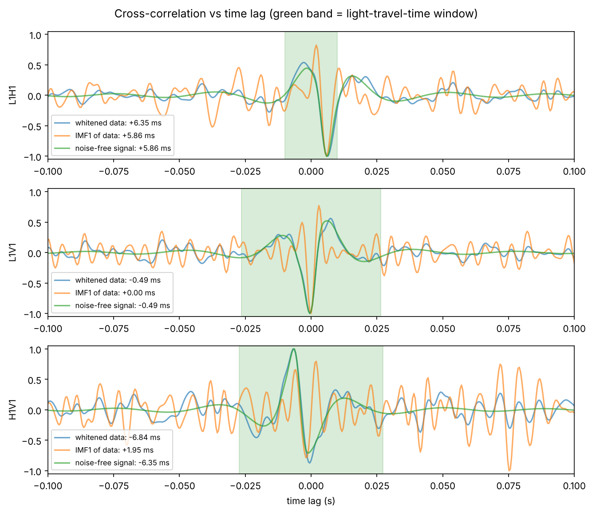
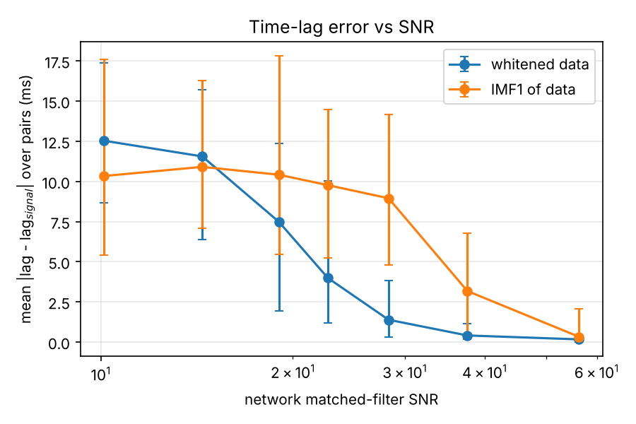
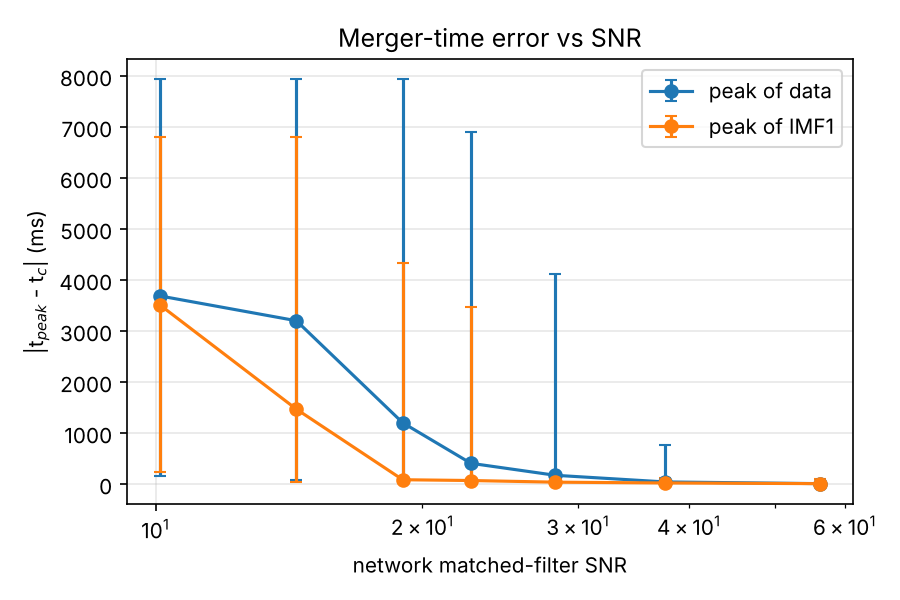

# gwhht - Hilbert-Huang transform and time-lag estimation for simulated GW signals

Python package + notebooks that inject a compact-binary signal into a three-detector network (LIGO L1, H1 and Virgo V1),
analyse it with **empirical mode decomposition / the Hilbert-Huang transform (HHT)**, and estimate the **inter-detector
time lags** and **merger time** by cross-correlation. A Monte-Carlo benchmark quantifies how the errors depend on SNR.



## Results (30 noise realisations per distance, 9 + 8 M☉ BBH, L1/H1/V1)

Median errors. *Lag error* = |lag - lag of the noise-free signal|, averaged over the 3 detector pairs.
*Merger error* = |t<sub>peak</sub> - t<sub>c</sub>|.

| distance (Mpc) | network SNR | lag err, whitened data (ms) | lag err, IMF1 (ms) | merger err, data peak (ms) | merger err, IMF1 peak (ms) |
|---:|---:|---:|---:|---:|---:|
| 200 | 56 | 0.16 | 0.33 | 7.6 | 7.6 |
| 300 | 38 | 0.41 | 3.2 | 41 | 21 |
| 400 | 28 | 1.4 | 9.0 | 171 | 37 |
| 500 | 23 | 4.0 | 9.8 | 406 | 69 |
| 600 | 19 | 7.5 | 10.4 | 1200 | 84 |
| 800 | 14 | 11.6 | 10.9 | 3201 | 1468 |
| 1200 | 10 | 12.5 | 10.3 | 3687 | 3512 |




**What this shows**

- *Time lag:* plain cross-correlation of the whitened data is more accurate than cross-correlating IMF1 at every SNR above ~15.
  Below that, both are at chance level (errors of 10-12 ms, comparable to the width of the allowed light-travel-time windows).
- *Merger time:* taking the peak of IMF1 instead of the raw whitened data reduces the error by a factor ~5-15 at SNR 20-40.
  A plausible explanation is that IMF1 acts like a high-pass filter that suppresses low-frequency noise
  (not tested here). Both estimators fail below SNR ~15.
- Both estimators are deliberately simple (a single peak / correlation maximum); they are baselines, not optimal estimators.

## Repository layout

```
src/gwhht/        config, simulate, preprocess, snr, hht, timelag, pipeline, benchmark, plotting
notebooks/        01 simulation + SNR | 02 EMD/HHT | 03 cross-correlation lags | 04 benchmark (outputs included)
scripts/          run_pipeline.py (single run + figures), run_benchmark.py (Monte Carlo)
configs/          default.yaml - every physical / analysis parameter
tests/            pytest: EMD reconstruction, lag recovery, filtering, reproducibility
results/          benchmark.csv and figures produced by the scripts
docs/method.md    method details and conventions
archive/          the two original exploratory notebooks
```

## Install

```bash
conda env create -f environment.yml && conda activate gwhht     # PyCBC is easiest from conda-forge
# or: pip install -e ".[pycbc,dev]"
```

## Usage

```bash
python scripts/run_pipeline.py --config configs/default.yaml --out results                 # one run + figures
python scripts/run_benchmark.py --distances 200 300 400 500 600 800 1200 --n-trials 30     # Monte Carlo
pytest                                                                                     # tests
```

```python
from gwhht.config import load_config
from gwhht.pipeline import run_single

res = run_single(load_config("configs/default.yaml"), seed=1, distance=300)
print(res.metrics["snr_network"], res.metrics["lag_imf1_L1H1"])
```

## Author
Tarun Kumar
